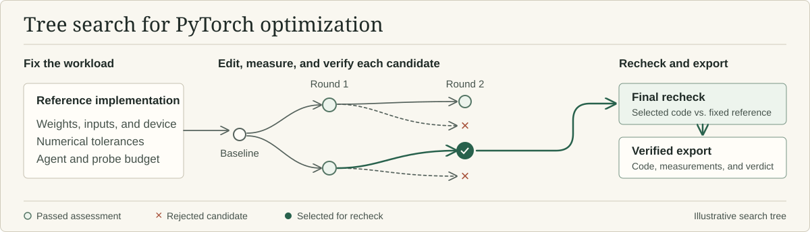

<h1 align="center">AutoPipeline</h1>

<p align="center"><strong>Tree search for verified PyTorch optimizations</strong></p>

<p align="center">
  
</p>

<p align="center">
  <a href="https://github.com/LyrineYang/Autopipeline/actions/workflows/ci.yml"></a>
  <a href="pyproject.toml"></a>
  <a href="CHANGELOG.md"></a>
  <a href="LICENSE"></a>
</p>

<p align="center">
  <a href="#quick-start">Quick Start</a> ·
  <a href="docs/quickstart.md">Guide</a> ·
  <a href="examples/README.md">Examples</a> ·
  <a href="docs/architecture.md">Architecture</a> ·
  <a href="docs/dev/handoff.md">Handoff</a>
</p>

Give AutoPipeline a reference implementation, representative inputs, and a device. A coding agent
tries different implementations. AutoPipeline checks their outputs and measures forward latency
against the fixed reference, then keeps up to two branches per round by default. The native
workflow ranks candidates by paired speedup and rechecks the selected implementation before export.

| Search within a budget | Judge changes independently | Keep a reproducible result |
| --- | --- | --- |
| Set rounds, candidates per branch, and agent calls. | Compare seeded outputs, record latency samples, and collect an operator profile. | Export the selected code, reference, and verification records for a fresh evaluation. |

## Quick Start

Use Python 3.10 or newer. The built-in residual MLP uses random weights and runs on CPU without an
agent account. If you already have a source checkout, start at the virtual environment step.
See the [installation guide](docs/quickstart.md#installation) for wheels and existing PyTorch environments.

```sh
git clone --branch main https://github.com/LyrineYang/Autopipeline.git autopipeline
cd autopipeline
python3 -m venv .venv
source .venv/bin/activate
python -m pip install '.[cpu]'

autopipeline pipeline init workspace/demo --device cpu
autopipeline pipeline check --spec workspace/demo/pipeline.json
autopipeline pipeline evaluate --spec workspace/demo/pipeline.json --run-dir workspace/demo/runs/baseline
autopipeline report workspace/demo/runs/baseline
```

Open `workspace/demo/runs/baseline/view/dashboard.html` for the verification result, measured
latency, and profile. The initial candidate uses the reference implementation, so the first
evaluation gives you a baseline.

## Run a Tree Search

On the execution machine, install and authenticate Codex CLI. You can also supply another coding
agent with `--executor-command`. [Agent setup](docs/quickstart.md#connect-a-coding-agent)

```sh
autopipeline pipeline run --spec workspace/demo/pipeline.json \
  --run-dir workspace/demo/runs/search --executor-backend codex-app-server \
  --max-rounds 2 --beam-width 2 --children-per-expansion 2 \
  --max-agent-calls 4 --max-probe-calls 4
autopipeline report workspace/demo/runs/search
```

If two first-round candidates pass, both can be tried before either gets a second child.
The example uses at most four agent calls. Search uses your configured service quota. The report
shows the selected candidate and whether it passed the final check.

## Bring Your Own Workload

| Workload | Starting point |
| --- | --- |
| Residual MLP or a small Transformer block | `pipeline init --example residual-mlp` or `--example attention` |
| Local Transformers encoder | `pipeline init --example hf-local --model-dir /path/to/encoder` |
| Any compatible PyTorch module | `pipeline init --source /path/to/workload` |

Custom workloads provide `reference.py` with `Model` and `get_inputs()`. The agent edits
`candidate.py` by default. The native evaluator measures synchronized `forward()` calls.
For custom execution contracts, see the [developer guide](docs/dev/README.md).
[Export and recheck a result](docs/quickstart.md#export-and-recheck) · [Explore all examples](examples/README.md)

## Project Status

**Alpha.** CPU installation, model evaluation, export, and a real-agent pilot have been exercised.
The RTX 4060 experiment will test CUDA compatibility and whether keeping multiple branches
improves repeatable latency at the same agent budget. [Experiment handoff](docs/dev/handoff.md)

AutoPipeline builds on [AutoKernel](https://github.com/RightNow-AI/autokernel). The original
kernel tools and KernelBench integrations are available from a source checkout.
[Contributing](CONTRIBUTING.md) · [Changelog](CHANGELOG.md) · [MIT license](LICENSE)
