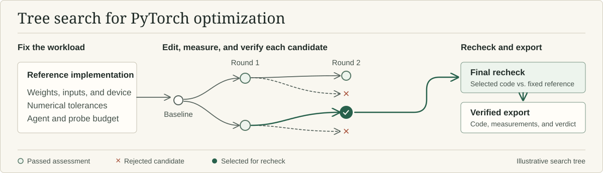

# Architecture



## Follow One Run

```text
autopipeline pipeline evaluate | run
  pipeline_cli.py        Parse CLI options and render the outcome
  workflow.py            Freeze the reference, configure the run, write the receipt
    search/engine.py     Evaluate the baseline and, for run, expand and rank branches
      search/branch_engine.py   Edit one candidate and assess it
      pipeline/task.py          Prepare copies, evaluate candidates, recheck the selected code
        pipeline/verification_backend.py  Run the pair and decide acceptance
          evaluate.py    Measure and compare seeded PyTorch forward outputs
  report.py              Read the receipt and render the search history
```

`evaluate` uses the same fixed reference and final recheck with zero search rounds. A valid
baseline is required before the product starts an agent. [Workflow](../autopipeline/workflow.py)

## Vocabulary

| Term | Meaning |
| --- | --- |
| Reference | The fixed implementation and inputs used for comparison. The run stores a frozen copy under `input/workload/`. |
| Baseline | The initial candidate and root node. `--candidate` can choose a starting implementation separately from the reference. |
| Candidate | An editable workspace produced from a parent. By default only `candidate.py` can change. |
| Forward latency | Synchronized `forward()` time in milliseconds. Model loading and input preparation are outside that timing window. |
| Ranking score | Higher-is-better score used to order passing nodes. For native latency workloads this is the paired reference latency divided by the candidate latency. |
| Verification verdict | The correctness and performance decision for a pair. Export also requires the selected code to pass the final recheck and match the receipt hashes. |

The native planner sees measured forward metrics, the available operator profile, and editable
paths. Task adapters with measured stage or communication data can supply more detailed
planning evidence. The tree's depth, edits within a branch, and agent/probe caps have separate
controls. Text stopping guidance goes to the agent. [Workload planning](../autopipeline/pipeline/planning.py) · [Search policy](../autopipeline/search/types.py)

## Where a Change Belongs

| Change | Source |
| --- | --- |
| CLI and user messages | [pipeline_cli.py](../autopipeline/pipeline_cli.py) and [presentation.py](../autopipeline/presentation.py) |
| Freeze, run, receipt, or export | [workflow.py](../autopipeline/workflow.py) |
| Workspace configuration or assessment | [autopipeline/pipeline/](../autopipeline/pipeline/) |
| Tree scheduling, role calls, feedback, or probes | [autopipeline/search/](../autopipeline/search/) |
| Extracted kernels from the source checkout | [kernel_tools/](../kernel_tools/) and [tree_optimize.py](../tree_optimize.py) |
| KernelBench integration | [kernelbench/](../kernelbench/) |

The search task protocol defines the required lifecycle. The engine discovers optional probe,
workspace, checkpoint, or planning hooks only when an adapter implements them. The default
product connects a model to the executor. Planning and reflection use local rules unless a
backend is configured for those roles. [Task protocol](../autopipeline/search/task.py) ·
[Agent contract](agent_contract.md)

## Compatibility and Context

The wheel installs one top-level package, `autopipeline`. Use `autopipeline.search` and
`autopipeline.pipeline` when porting Python integrations. Source checkouts retain aliases for
the historical `tree` and `pipeline` imports. Use `autopipeline kernel run` for the extracted
kernel workflow. `autopipeline tree run` is its compatibility alias.

Start with [Quickstart](quickstart.md) for commands, [Run Artifacts](dev/run-artifacts.md) for
reproducibility and counters, and [Handoff](dev/handoff.md) for current experiment evidence.
Historical design notes live under [the developer guide](dev/README.md#historical-design).
